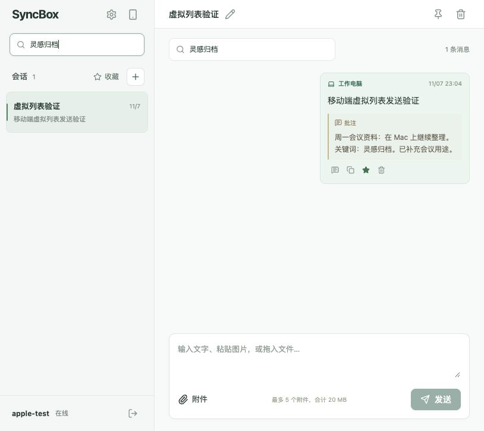

# 共享消息批注验收

## 范围

后端添加 annotation 持久字段及 PATCH 校验，四类搜索入口包含批注。Web、Apple（iOS/iPadOS/macOS）、Flutter（Android/Windows）接入展示、编辑和清除。每条消息一份批注，最多 2000 字符，共享可编辑，最后写入覆盖。

## 验证

- 后端 14 项测试全部通过：批注保存、修改、清空、跨会话凭证读取、匿名拒绝、非法值和长度限制、LIKE 特殊字符、四类搜索入口；现有功能回归通过。
- 后端/Web 最终构建通过。
- Web 使用独立 3001/5174 服务及临时数据库：新增、在收藏中编辑、全局/当前会话/收藏搜索独有批注关键词、删除确认后取消、长批注展开均正常。
- 814×724 和 390×844 验证：批注卡片/编辑窗口没有横向溢出，虚拟列表自动适配高度；编辑入口自动聚焦文本框。
- Apple 13 项测试通过，包括真实本地测试后端的 Mac 写入、iPhone 凭证读取/搜索/清除批注。iOS Simulator 与 macOS 的 xcodebuild 均 BUILD SUCCEEDED。
- Flutter analyze 无问题，16 项测试通过，涵盖旧响应兼容、PATCH 请求、失败保留草稿和重试关闭、删除二次确认，以及原有移动/桌面组件回归。

## 边界

未执行实际用户消息删除。Android/Windows 本次完成共用 Flutter 源码、静态检查与组件测试，尚未在原生目标设备运行或打包。Apple 完成编译和 API 测试，未发布安装包。历史消息批注默认空字符串，原内容保留。

