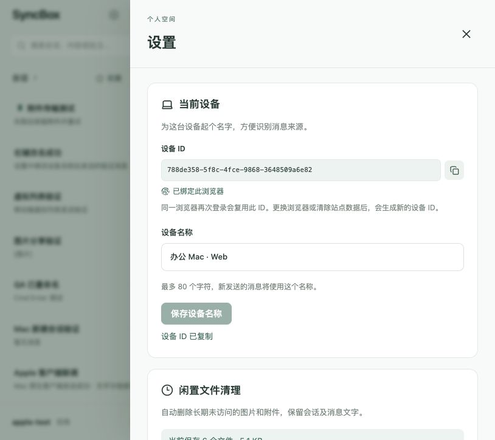

# 设备 ID 与浏览器绑定验收

实现：新增数据库迁移 1794000000009，保存安装标识和环境指纹摘要；唯一索引防止同一账号/平台/安装重复记录。Web 登录和恢复会话绑定当前浏览器，在设置中展示/复制设备 ID 与绑定状态，设备列表显示 ID。

- 后端 15 项测试通过，包括旧设备原 ID/名称迁移、重复和并发登记复用、环境变化保留 ID、相同环境但不同安装不合并、错误安装绑定 409、输入校验、匿名拒绝、旧客户端兼容、摘要不泄漏及已有功能回归。
- Web 3 项设备标识测试通过：仅使用 getRandomValues 的环境、持久化/账号隔离/清空后新标识、存储不可用错误、有限环境信息。
- 后端及 Web 构建通过。
- 隔离后端/页面 3001/5174：测试旧 Web 设备绑定后保留自定义名称；设置显示已绑定；复制成功；退出重登及刷新恢复后 ID 一致；浏览器控制台无错误。

范围：本次改动后端和 Web。原生端继续使用原设备 ID 注册协议，兼容新响应；未宣称原生硬件指纹支持。环境指纹只是辅助数据，只有安装标识用于复用，不能替代登录或作为物理设备证明。

