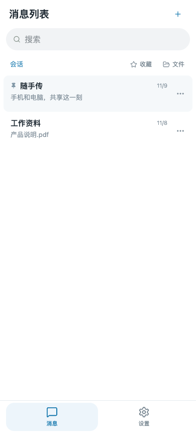
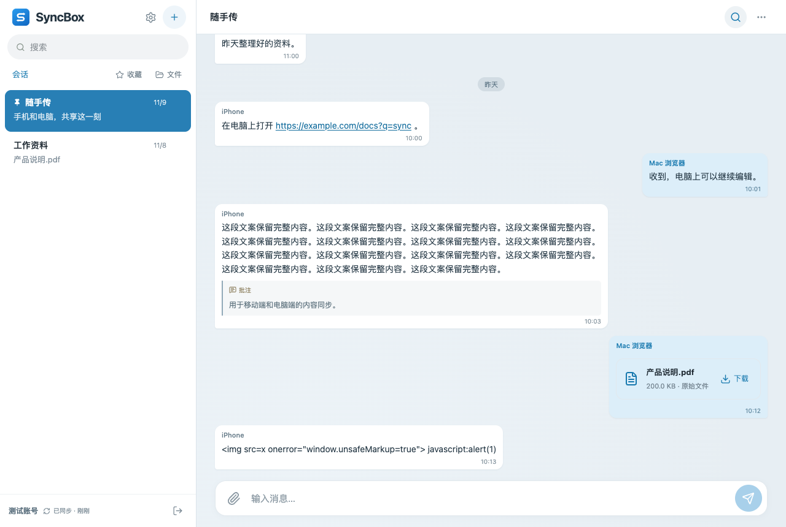
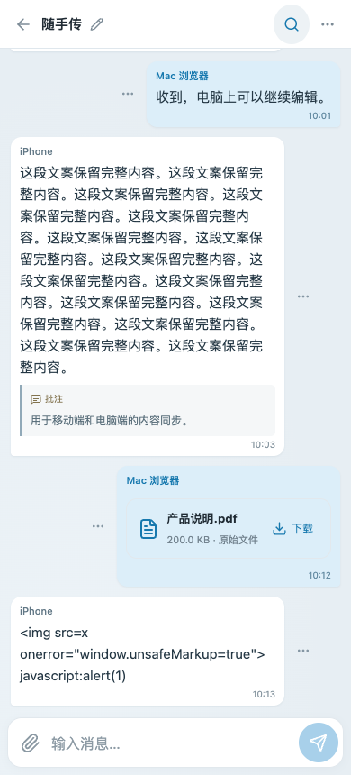

# Telegram 界面对照与首轮修正（2026-11-10）

## 参考来源与范围

- [Telegram 官方 Android 改版](https://telegram.org/blog/crafting-android-design-and-more#massive-redesign)：实际查阅正文、聊天列表图，并从官方演示视频截取底部导航和设置分组画面。
- [Telegram 官方 iOS Liquid Glass 说明](https://telegram.org/blog/new-design-ai-summaries#new-design)：查阅系统透明材质说明和演示；同时参考上一链接的 iOS 聊天界面图。不能用 Web 的半透明 CSS 代替原生折射效果的验收。
- [Telegram Desktop 官方页面](https://desktop.telegram.org/)：确认官方入口；该页面没有可用于逐像素比较的聊天截图，因此本次不宣称完成桌面端像素级还原。
- 项目原有 `telegram-desktop-2026-11-09.png` 等图片是 **SyncBox 测试截图**，不是 Telegram 官方设计图。

本次使用官方公开界面作为信息层级和操作模式的依据，没有取得 Telegram 的 Figma 源设计。Web 做了实际修改和浏览器回归；Android 读取已安装应用的 ADB 画面并检查 Flutter 源码；Apple 检查 SwiftUI 导航代码，未重新进行 iPhone 真机或 iOS 模拟器视觉验收。

## 对照结果

| 项目 | 本次检查与修正 | 状态 |
| --- | --- | --- |
| 手机主导航 | Web 原来是桌面侧栏缩窄；现在列表和设置通过底部“消息 / 设置”切换，聊天详情隐藏底栏 | Web 已修正；Flutter / Apple 原有双 Tab 保留 |
| 列表标题与新建入口 | Web 手机标题改为“消息列表”，新建移至标题右侧，搜索使用整行宽度 | 已修正 |
| 会话列表密度 | Web 桌面行高从 76 收敛到 68px，手机从 78 到 72px；保留日期、预览和置顶状态 | 已修正；这些尺寸是 SyncBox 适配值，并非官方测量值 |
| 聊天标题栏 | Web 置顶移入更多菜单；保留用户指定的标题旁改名、搜索和更多 | 已修正 |
| 设置呈现 | 手机使用独立可滚动设置页面，电脑保留侧边面板；账号及退出入口归入手机设置；设备名称优先，设备 ID/指纹说明折叠 | 已修正 |
| 消息气泡 | 左右区分当前设备，文字、时间和附件保持清晰；批注仍是 SyncBox 专有内容 | 既有功能已回归；未宣称与所有 Telegram 主题逐像素一致 |
| 操作菜单 | 电脑右键、手机长按以及可访问的更多按钮；删除确认、菜单后批注输入焦点正确 | Web 回归通过 |
| 输入与搜索 | 电脑 Enter 发送、Shift+Enter 换行；手机回车换行；保护中文输入；正文/链接/批注/文件名搜索高亮 | Web 回归通过 |
| Android 标题/媒体排布 | ADB 画面仍有标题截断、右侧图标较密，图片文件卡片的信息占比较大 | 记录为后续视觉修正项；本轮未更新 APK |
| iOS 材质与手势 | 源码使用系统 TabView，iOS 26+ 由系统提供 Liquid Glass；未验证实际设备的材质、转场及返回手势 | 待真机视觉验收，不标记为完全还原 |

按用户原有要求继续保留 SyncBox 标识、无头像、无未读数字、设备来源名、批注和私有部署设置；系统分享不做。Telegram 的联系人、通话、故事、反应和社交状态不作为本项目需要补齐的功能。

## 交互保护

- 消息草稿在返回列表、打开设置、再进入原会话后保留，不自动发送。
- 保存设置期间禁止切换底部导航；恢复码尚未确认保存时同样禁止离开。
- 手机设置不使用弹窗焦点锁，键盘可到达底部主导航；桌面设置继续使用弹窗语义和焦点约束。
- 在设置页切换手机/桌面宽度时，页面切换为对应布局，保留当前设置状态。
- 设备列表可从手机设置打开，关闭后仍回到设置。

## 多图片消息

同一条消息中的多个图片现在使用相册网格：两张并排，三张采用一张大图加两张小图，五张的最后一张跨两列；文件名和大小保留在缩略图下方，下载按钮叠加在图片右下角。点击任一缩略图后进入统一图片查看器，支持键盘左右键、移动端左右滑动、上一张/下一张和完整图片预览。非图片附件继续使用原来的文件卡片。

多图片回归截图：

- [桌面多图片](/Users/theo/app/SyncBox/docs/testing/screenshots/telegram-fidelity-2026-11-10/multi-image-desktop.png)
- [手机多图片](/Users/theo/app/SyncBox/docs/testing/screenshots/telegram-fidelity-2026-11-10/multi-image-mobile.png)

## 验证

- Web TypeScript 检查、Vite 生产构建通过。现有约 520kB 的单 JS chunk 体积提示仍存在。
- 19 项 Web 单元测试通过。
- 隔离浏览器测试使用模拟 API，不修改真实账号、消息、附件或两步认证。
- 新增 360 / 390 / 768 / 1280px 导航回归，检查标题右侧新建、设置页面/桌面面板、导航锁定、恢复码确认、设备标识展开、尺寸切换及草稿保留。
- 新增 1280 / 390px 多图片回归，检查相册网格、每张图片下载按钮、上一张/下一张、键盘切换和图片查看器关闭。
- 原有 1280 / 913 / 390px 聊天气泡、右键/触屏长按菜单、输入法保护、发送失败保留草稿、图片预览、搜索高亮回归通过。
- 390×340px 模拟键盘压缩下，长草稿与 5 个附件时仍可触达发送按钮。此项是浏览器视口模拟，不等于真机软键盘验收。

可复现命令（使用本机已有 Playwright）：

```sh
PLAYWRIGHT_MODULE=/private/tmp/syncbox-web-browser-check/node_modules/playwright-core/index.mjs \
SYNCBOX_SCREENSHOTS=/private/tmp/syncbox-ui-final \
node frontend/web/tests/telegram-workspace.browser.mjs
```

## 修正后截图






