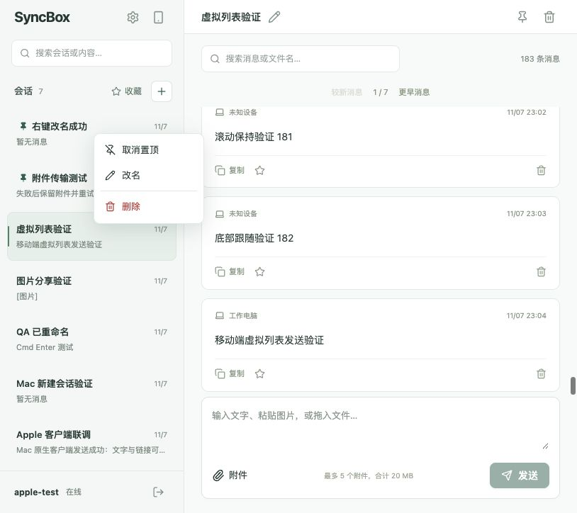

# Web 会话菜单与虚拟列表验收

日期：2026-11-07。使用隔离后端 3001、Web 5174、临时 SQLite 数据库，未改动实际服务数据。

## 实现范围

- 新增 ConversationContextMenu：Radix 右键菜单，置顶/取消置顶、改名、删除。
- 会话操作捕获目标对象，支持操作非当前会话，删除继续使用确认弹窗。
- 菜单焦点陷阱卸载后再打开改名弹窗，输入框自动聚焦。
- 新增 VirtualMessageFeed：react-virtuoso 动态高度渲染；稳定消息 ID 和虚拟索引，适应最新页滚动窗口更新。
- 保留每页 30 条分页和搜索；底部跟随、历史阅读位置保持、回到底部、发送后定位。

## 验证结果

- `npm run build -w @syncbox/web`：通过（含 TypeScript 检查）。
- 180 条混合长度消息，6 页：最新页底部仅挂载 2 行，上滚后挂载 4 行，少于该页 30 条。
- 向上阅读时新增消息：同一可见消息的屏幕纵坐标保持不变；底部状态下新增消息后 scrollHeight - scrollTop - clientHeight = 0。
- 翻至历史页从顶部显示，搜索指定消息返回 1 条正确结果。
- 图片加载及全屏预览正常，预览覆盖完整视口。
- 390×844 手机视口发送消息成功；814×724 桌面视口正常。
- 对非当前会话置顶、取消置顶、改名成功，当前会话保持不变。
- 删除确认显示右键目标会话名称，取消后保留数据；未执行永久删除。
- Escape 关闭菜单，焦点回到原会话行。
- 浏览器控制台未发现 warning/error。

原有分页继续保留，本次不是无限滚动历史加载。右键菜单依赖浏览器 contextmenu 事件，未增加 Shift+F10 快捷键处理。

截图：
