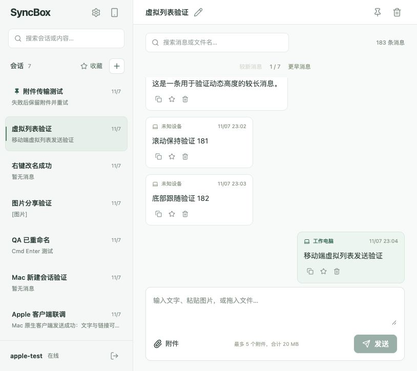

# 消息来源布局验收

日期：2026-11-07。仅修改 Web，使用隔离测试服务 3001/5174 和临时数据库。

- 按 `session.user.deviceId` 与 `message.senderDevice.id` 比较；缺失 ID 不判定为本机。
- 当前设备消息右对齐、浅绿色背景、设备名称高亮；其他设备左对齐。
- 消息卡片随内容宽度收缩，减少留白，移除操作区分隔线及重复文字。
- 操作图标 13px，点击区域桌面 24px / 手机 28px，保留悬浮提示、无障碍名称和焦点样式。
- `npm run build -w @syncbox/web` 通过，包含 TypeScript 检查。
- 814×724：其他来源消息左边界 284px；本机消息右边界 790px，短消息卡片约 100px 高。
- 390×844：图片、多个附件、文件名正常显示，页面和卡片无横向溢出。
- 复制按钮显示“已复制”，收藏按钮切换为“取消收藏”；控制台无 warning/error。

