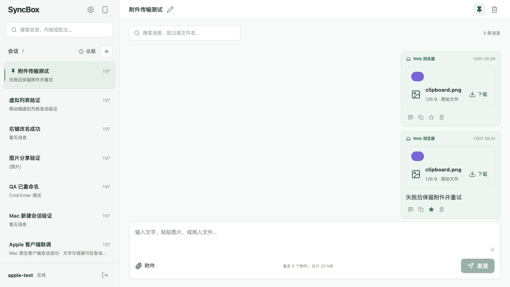

# 重复选择会话回归验证

问题：点击当前已选中的会话时，select() 无条件清空消息，但 selected.id、搜索词、页码均未改变，加载 effect 不会重新触发，消息区暂时显示为空。

修复：同一会话的重复选择直接返回，保留消息、分页、搜索条件及虚拟列表状态；真正切换会话仍正常清空并请求新历史。

使用隔离服务 3001/5174 验证：
- 最新页连续点击 3 次：总数保持 183，挂载消息行保持 4 行。
- 历史页连续点击：保持第 2/7 页及当前消息。
- 会话 A→B→A→B 快速切换：最终正确显示 B 的 3 条消息和附件。
- B 重复点击后内容保留，控制台无 warning/error。
- Web TypeScript 检查及生产构建通过。

截图：
