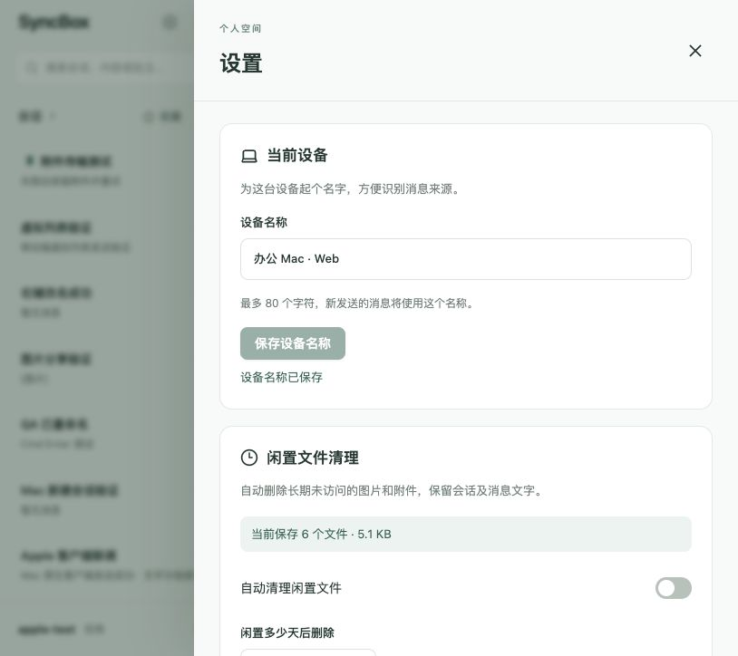

# 设置面板当前设备改名

新增 CurrentDeviceSettings 组件，在设置首页顶部读取当前登录会话绑定的设备，并复用 PATCH /devices/:id 接口改名。支持 1–80 字符，去除首尾空白；空白或未修改时保存按钮禁用。加载失败可重试，保存失败保留草稿，保存时阻止重复提交及关闭设置。

隔离 3001/5174 测试通过：
- 读取原名称，空白输入无法提交。
- 保存“办公 Mac · Web”成功，首尾空格被去除。
- 打开设备列表显示一致的新名称，仍标记当前设备。
- 新发送的消息记录新设备名。
- 重新打开设置读回已保存名称。
- 814×724 桌面及 390×844 手机布局正常，控制台无 warning/error。
- Web TypeScript 检查和生产构建通过；后端接口无需变更。

